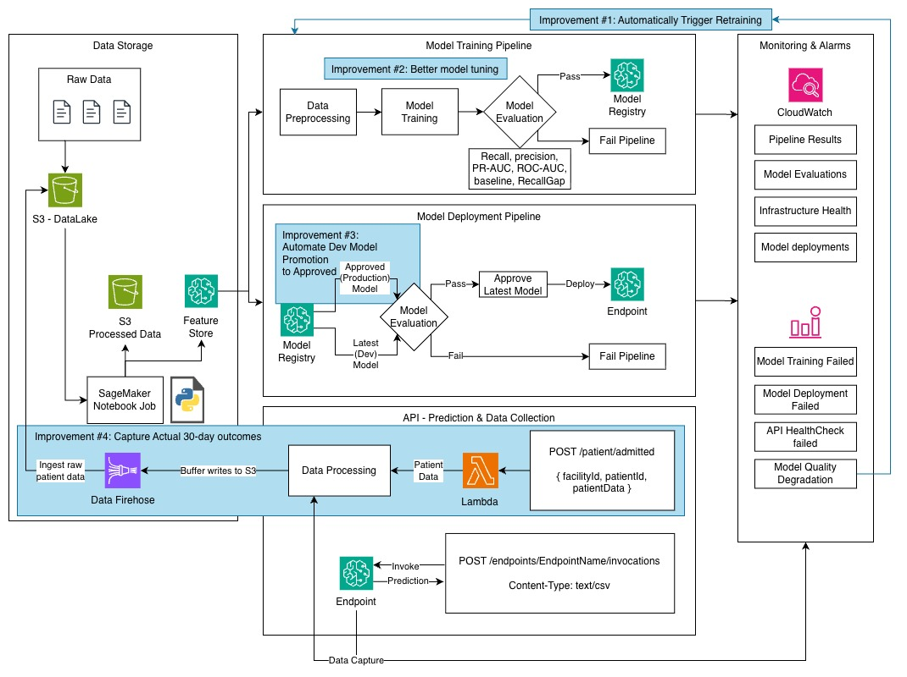

# Diabetes Readmission Prediction

AAI-540 Group 5 project. We use the Diabetes 130-US Hospitals data to predict whether a patient will be readmitted within 30 days. The model returns a floating-point risk score between 0.0 and 1.0. A score at or above a threshold tuned on validation data is classified as a predicted readmission in less than 30 days; a score below it is not. The saved model's threshold is about 0.4362. This is a class project and its predictions are not for clinical decisions.

## Project workflow

1. Load the hospital encounter data and ID mappings. Clean missing values, group diagnosis codes, and prepare the features.
2. Split patients into training (70%), validation (15%), and test (15%) sets. All encounters for one patient stay in the same set.
3. Train a logistic regression baseline and three XGBoost candidates. Choose the XGBoost model by validation PR-AUC, then choose a prediction threshold on validation data with a target of at least 70% recall.
4. Evaluate once on the test set. Check recall, precision, PR-AUC, ROC-AUC, the confusion matrix, and results by race, gender, and age.
5. Save the model and evaluation files, register the model in SageMaker, and deploy a real-time endpoint with request and response capture.
6. Check captured traffic for drift and publish metrics and an alarm to CloudWatch.
7. Set up a repeatable SageMaker Pipeline that extracts data from Feature Store, preprocesses it, trains and evaluates a model, and registers it only if all performance and fairness gates pass.

The full MLOps setup is covered by notebooks **01 through 05** in [`notebooks/setup/`](notebooks/setup/). The notebooks in [`notebooks/development/`](notebooks/development/) are the experiments and checks we used while developing the project. They are useful for testing and exploration, but they are not required to set up the infrastructure.

## Repository files

| Path | Purpose |
| --- | --- |
| [`data/`](data/) | Hospital encounter data and `IDS_mapping.csv` lookup file. |
| [`notebooks/setup/`](notebooks/setup/) | The five notebooks for the full MLOps setup, along with the pipeline's feature extraction, preprocessing, and evaluation scripts. |
| [`notebooks/setup/artifacts/`](notebooks/setup/artifacts/) | Saved processed data, model, preprocessor, evaluation results, and fairness tables from model initialization. |
| [`notebooks/development/00-models.ipynb`](notebooks/development/00-models.ipynb) | Majority-class benchmark used during development. |
| [`notebooks/development/01_data_ingestion_eda.ipynb`](notebooks/development/01_data_ingestion_eda.ipynb) | Early S3 ingestion, AWS Glue cataloging, and data exploration. |
| [`notebooks/development/evaluation/automated-model-evaluation.ipynb`](notebooks/development/evaluation/automated-model-evaluation.ipynb) | Local model evaluation and pass/fail quality gate experiments. |
| [`notebooks/development/evaluation/results/`](notebooks/development/evaluation/results/) | Saved quality gate report and comparison tables. |
| [`notebooks/development/monitor/cloudwatch-monitoring.ipynb`](notebooks/development/monitor/cloudwatch-monitoring.ipynb) | Exploration of drift and outcome metrics, CloudWatch alarms, and dashboards. |

## Run the notebooks

### Full MLOps setup

Use Python 3 and Jupyter in a SageMaker environment with an execution role that can access the AWS services used by the notebooks. These include S3, SageMaker, Feature Store, Glue, Athena, and CloudWatch. The notebooks use `boto3` and SageMaker SDK 2.x; keep the SageMaker SDK below version 3.

Model training and local checks also use `numpy`, `pandas`, `scipy`, `scikit-learn`, `xgboost`, `joblib`, and `matplotlib`. The saved preprocessor was created with **scikit-learn 1.4.2**, so use that version when loading it.

Run the following notebooks in order, from top to bottom. Keep each notebook's working directory set to [`notebooks/setup/`](notebooks/setup/) so its relative paths resolve correctly.

| Order | Notebook | What it does |
| --- | --- | --- |
| 01 | [`01-initialize-sagemaker.ipynb`](notebooks/setup/01-initialize-sagemaker.ipynb) | Prepares the hospital data, creates the SageMaker Feature Store feature group, ingests records, and verifies online retrieval. |
| 02 | [`02-initialize-model.ipynb`](notebooks/setup/02-initialize-model.ipynb) | Prepares features, creates patient-level splits, trains and evaluates the models, saves artifacts, and registers the selected model. |
| 03 | [`03-initialize-endpoint.ipynb`](notebooks/setup/03-initialize-endpoint.ipynb) | Deploys the selected model's image and artifacts to a real-time endpoint, enables data capture, and checks endpoint predictions against the local model. |
| 04 | [`04-model-monitoring.ipynb`](notebooks/setup/04-model-monitoring.ipynb) | Builds a training baseline, sends test traffic, checks captured requests for drift, and publishes CloudWatch metrics and an alarm. |
| 05 | [`05-CI-CD-DAG.ipynb`](notebooks/setup/05-CI-CD-DAG.ipynb) | Creates and runs the SageMaker Pipeline for Feature Store extraction, preprocessing, training, evaluation, quality gates, and model registration. |

## Saved model results

The saved XGBoost model uses 500 trees, a maximum depth of 6, and a learning rate of 0.03. Its decision threshold is about 0.435. The included test report shows:

| Metric | Test result |
| --- | ---: |
| Recall | 0.7251 |
| Precision | 0.1614 |
| PR-AUC | 0.2287 |
| ROC-AUC | 0.6836 |
| F1 | 0.2641 |

The included quality gate report shows **PASS** for the example project thresholds: recall at least 0.70, precision at least 0.15, PR-AUC at least 0.20, ROC-AUC at least 0.65, and recall and PR-AUC above the majority-class benchmark. Precision is still low, so many positive predictions are false alarms. These thresholds are class-project checks, not clinical standards.

The endpoint notebook uses one `ml.m5.large` instance for real-time predictions. For the demo, it deploys the selected model package's image and artifacts directly without changing the package's registry approval status. Model initialization and the automated pipeline register models with `PendingManualApproval` status.

## System Architecture

The System Architecture diagram marks possible future work in blue. This includes newer hospital data, stronger data quality checks, more model tuning, expanded fairness checks, and monitoring with retraining when real outcomes become available. These are proposed improvements rather than completed features.
